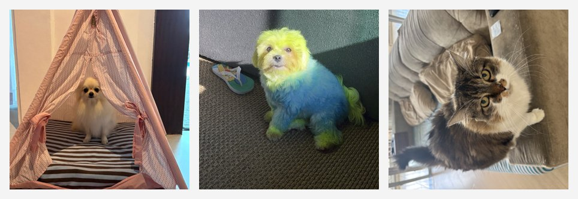

# 🐾 FECAP Pet — app Android

App Android em Java que lista pets e mostra a ficha de cada um em uma segunda tela. Feito como tarefa de aula de desenvolvimento mobile na FECAP.



## Funcionalidades

- Tela inicial com os pets separados em **Cães** e **Gatos**
- Ao tocar em um pet, abre a tela de detalhes com foto, nome, cor, raça, idade e aniversário
- Dados passados entre telas com `Intent` e objeto `Serializable`

## O que pratiquei

- Classe de modelo (`Pet`) com encapsulamento e getters
- Duas `Activity` e navegação entre elas com `Intent.putExtra`
- Layouts em XML (`ScrollView`, `LinearLayout`, `ImageView`, `Button`)
- Imagens como recursos (`res/drawable`)

## Tecnologias

- Java 11
- Android SDK (minSdk 24, targetSdk 34), AppCompat e Material Components
- Gradle (Kotlin DSL)

## Como rodar

1. Instale o [Android Studio](https://developer.android.com/studio).
2. Clone o repositório:
   ```bash
   git clone https://github.com/HenriqueJorgeMartinsFigueiredo/Aula06Tarefa.git
   ```
3. Abra a pasta no Android Studio e espere o Gradle sincronizar.
4. Rode em um emulador ou celular Android (botão ▶ Run).

## Estrutura

| Arquivo | O que faz |
|---|---|
| `Pet.java` | Modelo com os dados de cada pet |
| `MainActivity.java` | Tela inicial; cria os pets e abre os detalhes |
| `DetalhesPetActivity.java` | Recebe o pet e preenche a tela de detalhes |
| `res/layout/` | `activity_main.xml` e `activity_detalhes.xml` |

---

Feito por [Henrique Jorge](https://github.com/HenriqueJorgeMartinsFigueiredo).
